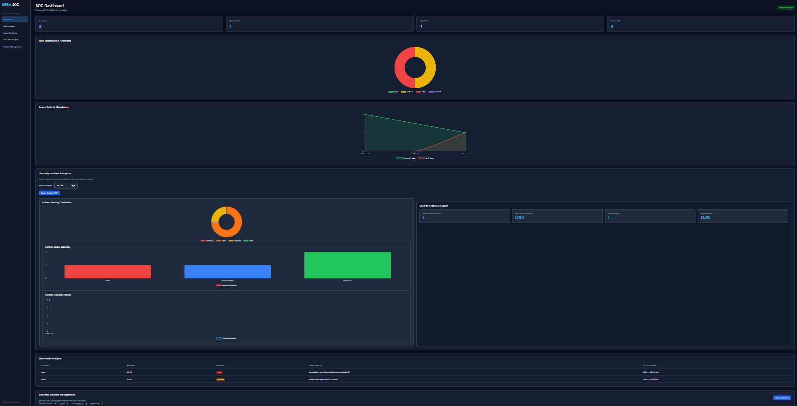
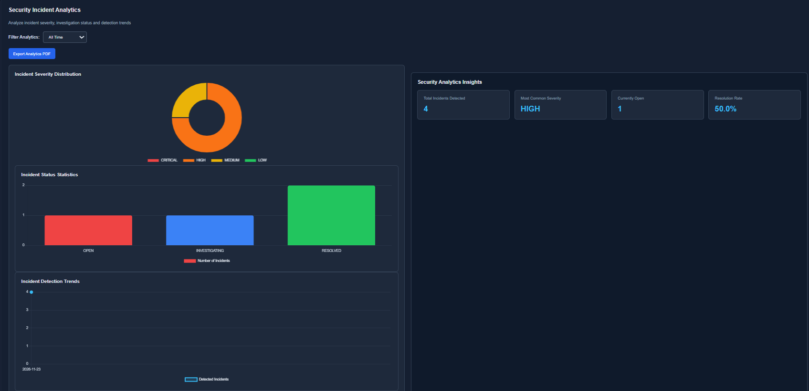
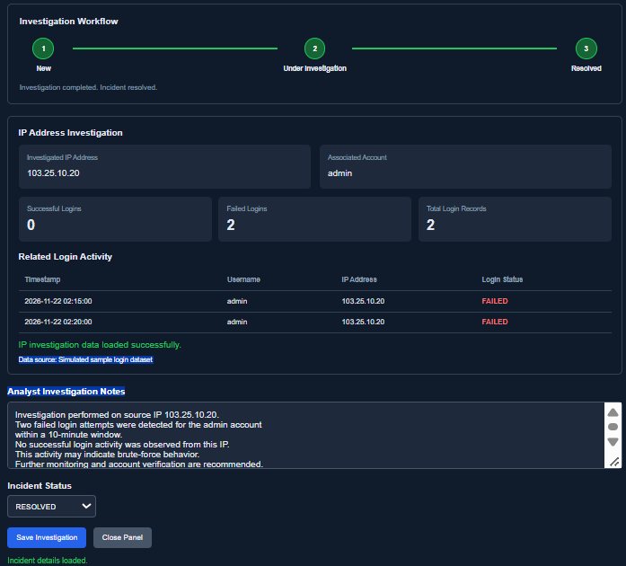
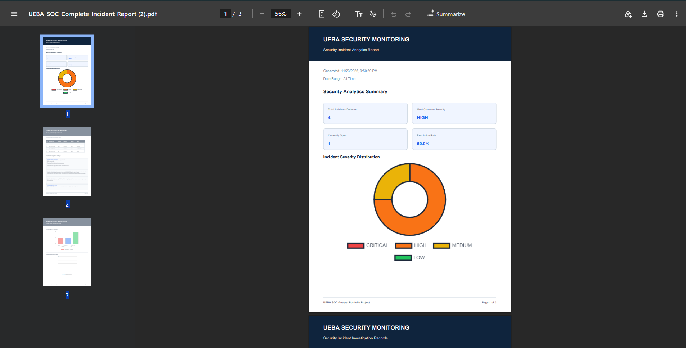

# UEBA Security Monitoring System

A Python-based User and Entity Behavior Analytics (UEBA) Security Monitoring System developed as a SOC Analyst portfolio project.

The system analyzes login activity, identifies unusual login behavior, calculates risk scores, and helps security analysts investigate and manage security incidents through a web-based dashboard.

## Project Overview

User and Entity Behavior Analytics (UEBA) helps security teams identify potentially suspicious activities by analyzing user behavior patterns.

This project demonstrates a basic UEBA monitoring workflow using simulated login activity and predefined baseline IP addresses.

## Objectives

- Monitor user login activity.
- Identify logins from unfamiliar IP addresses.
- Detect repeated failed login attempts.
- Calculate risk scores based on suspicious activity.
- Generate and manage security incidents.
- Provide investigation details and recommended actions.
- Maintain an audit history of investigation updates.

## Key Features

- **Login Activity Monitoring:** Review user login events.
- **Unusual IP Detection:** Identify login activity from IP addresses outside a user's baseline.
- **Failed Login Detection:** Identify repeated failed login attempts.
- **Risk Assessment:** Calculate risk scores and classify alert severity.
- **Incident Management:** View, search, filter, and update security incidents.
- **Investigation Workflow:** Record analyst notes and manage incident status.
- **Audit History:** Track investigation and status changes.
- **Analytics Dashboard:** Visualize incident severity, status, trends, and summary metrics.
- **PDF Reporting:** Export incident analytics and investigation findings as a PDF report.

## Technologies Used

| Technology | Purpose |
|---|---|
| Python | Backend development |
| Flask | Web application framework |
| SQLite | Incident and assessment storage |
| Pandas | Data handling |
| Scikit-learn | Machine learning library installed for project development |
| HTML | Dashboard structure |
| CSS | Dashboard styling |
| JavaScript | Dashboard functionality |
| Chart.js | Analytics visualizations |
| jsPDF | PDF report generation |
| Git and GitHub | Version control and project hosting |

## Project Structure

```text
UEBA-Security-Monitor/
│
├── app.py
├── requirements.txt
├── .gitignore
│
├── dashboard/
│   ├── static/
│   │   └── style.css
│   └── templates/
│       └── index.html
│
├── data/
│   ├── baseline_ips.csv
│   └── sample_logs.csv
│
├── database/
│   ├── __init__.py
│   └── db.py
│
├── detection/
│   ├── __init__.py
│   ├── behavior_analysis.py
│   ├── ip_detection.py
│   ├── risk_scoring.py
│   └── test_audit.py
│
├── reports/
├── screenshots/
└── tests/
```

## Detection Workflow
## Dashboard Screenshots

The following screenshots demonstrate the UEBA monitoring dashboard and its investigation capabilities.

### 1. Main UEBA Dashboard


### 2. Incident Analytics


### 3. Incident Investigation Panel


### 4. PDF Incident Report


---

1. Collect login activity from the sample dataset.
2. Compare login IP addresses against predefined user baseline IPs.
3. Identify unusual login activity and repeated failed login attempts.
4. Calculate risk scores based on detected behavior.
5. Generate security incidents.
6. Store incident information in SQLite.
7. Display incidents and analytics on the dashboard.
8. Allow analysts to investigate, add notes, and update incident status.

## Installation and Setup

### 1. Clone the repository

```bash
git clone https://github.com/Stuffjj/UEBA-Security-Monitor.git
```

### 2. Navigate to the project directory

```bash
cd UEBA-Security-Monitor
```

### 3. Create a virtual environment

```bash
python -m venv .venv
```

### 4. Activate the virtual environment

Windows PowerShell:

```powershell
.venv\Scripts\Activate.ps1
```

### 5. Install dependencies

```bash
pip install -r requirements.txt
```

### 6. Initialize the database

```bash
python -m database.db
```

### 7. Start the application

```bash
python app.py
```

### 8. Open the dashboard

Visit:

```text
http://127.0.0.1:5000
```

## Sample Data

The project includes sample login records and baseline IP addresses in the `data/` directory.

**Note:** The included login records are simulated for demonstration and testing. They do not represent verified real-world attacks or actual security incidents.

## Security Analyst Use Cases

- Investigating login activity from unfamiliar IP addresses.
- Reviewing repeated failed login attempts.
- Assessing suspicious user behavior.
- Prioritizing incidents based on risk severity.
- Documenting investigation findings.
- Tracking incident status and analyst actions.

## Future Enhancements

- Machine learning-based anomaly detection.
- Real-time Windows Event Log ingestion.
- Splunk integration.
- Email notifications for high-risk incidents.
- Advanced user behavior profiling.
- Enhanced threat intelligence integration.

## Project Purpose

This project was developed for hands-on learning and portfolio demonstration while building practical knowledge of SOC monitoring, security incident investigation, Python, Flask, and UEBA concepts.

## Author

**Sujan**

Cybersecurity | SOC Analyst Aspirant

GitHub: https://github.com/Stuffjj
